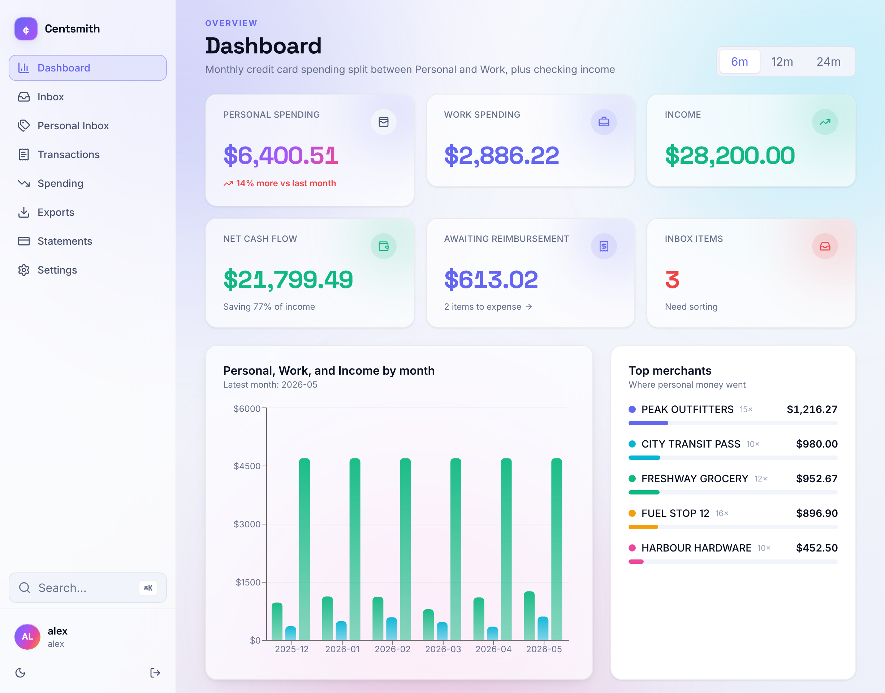

# Centsmith

[](https://github.com/williamhatcher4/Centsmith/actions/workflows/ci.yml)

A local-first Windows desktop app for importing credit card and bank statements, sorting each transaction into **Personal** or **Work**, analyzing personal spending, and tracking which work expenses have been reimbursed.

Everything runs on your own machine: a FastAPI backend and a React UI packaged inside a Tauri shell, with a local SQLite database. No cloud account, and your financial data never leaves your computer.



---

## Features

- **Statement import from many banks.** Supports CSV, XLS/XLSX, and OFX/QFX. Includes a preview-before-commit step, duplicate detection, saved column-mapping profiles for unfamiliar formats, day-first date support, and one-click undo of a whole import.
- **Two-stage triage.** An Inbox sorts new transactions into Personal or Work, then a Personal Inbox assigns spending categories. Categories you use are remembered automatically.
- **Spending analysis.** Shows monthly totals and averages, category breakdowns for a selected month or the whole range, and drill-down into the matching transactions.
- **Work expense tracking.** Mark work transactions as expensed, see what's still awaiting reimbursement, and export each group to CSV separately.
- **Cards and statement cycles.** Tracks billing cycles per card.
- **Data safety.** Creates backups automatically before updates, lets you choose your own backup folder, and includes a restore option and a data-diagnostics panel.
- **Desktop polish.** Includes a command palette, light/dark themes, signed auto-updates, and a launch screen that explains startup failures instead of spinning forever.

## Tech stack

| Layer | Technologies |
| --- | --- |
| Backend | Python, FastAPI, SQLAlchemy 2, Alembic, Pydantic Settings, SQLite |
| Frontend | React 19, TypeScript, Vite, TanStack Query, Zustand, Tailwind CSS, Recharts |
| Desktop | Tauri 2 (Rust), WebView2, PyInstaller backend sidecar, NSIS installer |
| Testing | pytest, Vitest + Testing Library + MSW, Playwright, `cargo test` |
| CI/CD | GitHub Actions: tests, coverage gates, dependency audits, signed releases with an auto-update manifest |

## Architecture

```
┌──────────────────────── Tauri shell (Rust) ────────────────────────┐
│  WebView2 window ──HTTP──▶  FastAPI sidecar (PyInstaller bundle)   │
│                              ├── /api/v1/*   REST API              │
│                              ├── /           built React app       │
│                              └── SQLite  (%APPDATA%\Centsmith)     │
└────────────────────────────────────────────────────────────────────┘
```

- **Startup handshake.** The sidecar picks a free local port and generates a one-time token. It writes both to a short-lived `runtime.json`, which the Rust shell reads and deletes. The shell then signs in through `/desktop-login?token=...`. The user never sees a login screen, but every API route still requires an authenticated session; desktop mode doesn't skip any checks.
- **Secrets at rest.** The session-signing key is encrypted with Windows DPAPI under the current user, so it can't be decrypted by another account or on another device.
- **Money is stored as integer cents** throughout, to avoid floating-point rounding errors.
- **Schema changes go through Alembic migrations.** A test checks that a database from an older released version upgrades cleanly to the current schema.
- **API contract.** A snapshot of the OpenAPI schema is checked in, and a test fails if the API changes unintentionally.
- **Statement parsing** lives in `backend/app/services/statement_parsing/`, which has a parser for each format. It's tested against a sample set of statement files in many layouts (`backend/tests/fixtures/corpus/`).

See [PROJECT_OVERVIEW.md](PROJECT_OVERVIEW.md) for a deeper walkthrough of flows, endpoints, the data model, and the release pipeline.

## Repository layout

```
backend/     FastAPI app, Alembic migrations, pytest suite
frontend/    React + TypeScript SPA, Vitest suite
desktop/     Tauri 2 shell (Rust) and startup loader
e2e/         Playwright end-to-end tests
packaging/   PyInstaller spec, build, signing, and release-validation scripts
.github/     CI and release workflows
```

## Running locally (developer mode)

**Prerequisites:** Windows, Python 3.12, Node.js LTS. Rust is only needed for the desktop shell.

```powershell
./start.ps1
```

On first run, the script creates `backend/.env` from `backend/.env.example` and exits. Set `ADMIN_USERNAME` and `ADMIN_PASSWORD` in that file, then run the script again. It will:

1. Create the backend virtual environment and install dependencies.
2. Run migrations and seed the local user.
3. Start the API at `http://127.0.0.1:8012` and the Vite dev server at `http://127.0.0.1:5175`.

Developer mode uses a normal username/password login, with rate limiting on failed attempts.

To build the desktop installer:

```powershell
./packaging/build.ps1
```

See [desktop/README.md](desktop/README.md) for the Rust toolchain prerequisites.

## Testing

```powershell
# Backend: pytest with an enforced coverage gate
.\backend\.venv\Scripts\python.exe -m pytest

# Frontend: lint, unit/component tests, type-checked build
npm --prefix frontend run lint
npm --prefix frontend run test
npm --prefix frontend run build

# Desktop shell
cargo test --manifest-path desktop\src-tauri\Cargo.toml

# End-to-end (Playwright)
npm --prefix e2e test
```

On every pull request, CI runs all of the above and also audits dependencies (`pip-audit`, `npm audit`, and `cargo audit`).

## Installing the app (end users)

1. Download the latest installer from [centsmith.ca](https://centsmith.ca) and run it.
2. Launch **Centsmith** from the desktop or Start Menu. The first launch takes a few seconds while the local server starts.

Requires Windows 10 or 11 (64-bit) and the WebView2 Runtime. WebView2 is preinstalled on Windows 11, and the installer offers to download it on Windows 10.

Your data lives in `%APPDATA%\Centsmith\centsmith.db`. Uninstalling leaves this folder in place; delete it manually to remove your data. If the app gets stuck on the loading screen, check Task Manager for a leftover `centsmith-backend.exe`, end it, and relaunch. Diagnostic logs are in `%APPDATA%\Centsmith\shell.log`.

## License

Copyright © 2026 William Hatcher. All rights reserved.

The source code is published for viewing and evaluation only. You may not copy, modify, distribute, or use this code without written permission.
